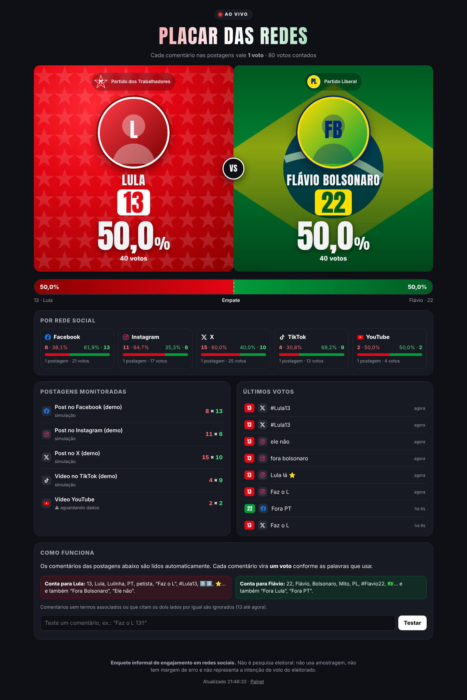
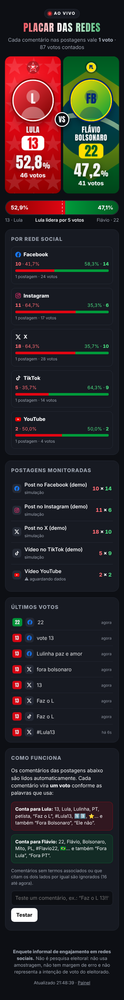

# Placar das Redes · Lula (13) × Flávio Bolsonaro (22)

Site que mostra, em tempo real, um placar em **porcentagem e quantidade** a partir dos
comentários de postagens no **Facebook, Instagram, X, TikTok** (e YouTube).
Cada comentário vale **1 voto**: `13` → Lula, `22` → Flávio.

- Esquerda: **Lula**, tema vermelho, estrela do **PT**.
- Direita: **Flávio Bolsonaro**, tema verde, bandeira do Brasil, **PL**.
- Atualização ao vivo (Server-Sent Events), barra de disputa, placar por rede, lista de postagens e feed dos últimos votos.
- Sem dependências: só Node.js 18+.

| Desktop | Celular |
|---|---|
|  |  |

## Rodar

```bash
cd placar-eleitoral
npm run demo     # modo demonstração: comentários simulados, sem credenciais
npm start        # modo real
```

- Placar público: http://localhost:3000
- Painel: http://localhost:3000/admin (o token aparece no terminal, ou defina `ADMIN_TOKEN`)

No painel, cole o link da postagem e clique em **Adicionar ao placar**. O site identifica a rede
e o ID sozinho e passa a ler os comentários a cada 30 s.

### Fotos

Coloque as fotos em `public/img/`:

- `lula.png` (ou `.jpg` / `.webp`): lado esquerdo
- `flavio.png` (ou `.jpg` / `.webp`): lado direito

Use retrato vertical (proporção 4:5, cerca de 800×1000), com o rosto no terço de cima. PNG com fundo
removido fica melhor: a foto "flutua" sobre o fundo vermelho ou verde. Sem foto, aparece uma silhueta.
Use fotos com licença que permita o uso (ex.: retratos oficiais da Agência Senado ou da Presidência, com crédito no rodapé).
Os selos de PT e PL são desenhos simples em SVG no `index.html`; troque pelos logos oficiais se tiver autorização.

## Como os comentários viram votos

Arquivo `lib/keywords.js` (edite à vontade):

| Lula | Flávio |
|---|---|
| 13, Lula, Lulinha, Lulão, “Lula lá”, PT, petista, lulista, “Faz o L”, #Lula13, 1️⃣3️⃣, ⭐ 🚩 | 22, Flávio, Flavinho, Bolsonaro, bolsonarista, Mito, PL, “zero um”, #Flavio22, 2️⃣2️⃣, 🇧🇷 |
| Rejeição do outro lado: “Fora Bolsonaro”, “Ele não”, “Bolsonaro nunca mais”… | Rejeição do outro lado: “Fora Lula”, “Fora PT”, “Lula ladrão”… |

Regras (`lib/classifier.js`):
1. O texto é normalizado: sem acentos, minúsculas, sem `#`/`@`, `lulaaaa` → `lula`, `#Lula13` → `lula 13`, emojis de número → dígitos.
2. Números só contam isolados: `13` conta, `2013` ou telefones não.
3. Cada termo dá 1 ponto ao lado dele; “fora X” dá ponto ao adversário (e não ao X).
4. Quem tiver mais pontos leva **1 voto**. Empate ou nenhum termo → comentário ignorado.
5. Cada comentário é contado uma vez só (pelo ID), mesmo sincronizando de novo.
6. Opcional: `ONE_VOTE_PER_USER=1` limita a 1 voto por pessoa por postagem.

Dá para testar qualquer frase na caixa “Testar” do site ou com `POST /api/testar {"texto": "..."}`.

## Leitura automática dos comentários (APIs oficiais)

Copie `.env.example` para `.env` e preencha as redes que for usar.

| Rede | O que precisa | Limitação importante |
|---|---|---|
| Facebook | Token de Página (`pages_read_engagement`) | Só posts de Páginas que você administra |
| Instagram | Conta profissional + token (`instagram_manage_comments`) | Só posts da **sua** conta profissional |
| X | Bearer token da API v2 com acesso a busca | `search/recent` cobre 7 dias; plano pago |
| TikTok | Research API (client key/secret) | Acesso só para pesquisadores aprovados |
| YouTube | Chave da Data API v3 | Qualquer vídeo público |

**Sem credencial** (ou para posts de terceiros), use **Importar comentários manualmente** no painel:
cole os comentários, um por linha. Colar a mesma lista de novo não duplica votos.

## API

| Método | Rota | Admin |
|---|---|---|
| GET | `/api/placar` | |
| GET | `/api/eventos` (SSE) | |
| POST | `/api/testar` `{texto}` | |
| POST | `/api/postagens` `{url, titulo?, idApi?}` | ✔ |
| DELETE | `/api/postagens/:id` | ✔ |
| POST | `/api/postagens/:id/sincronizar` | ✔ |
| POST | `/api/postagens/:id/comentarios` `{texto}` | ✔ |

Rotas de admin exigem o cabeçalho `x-admin-token`. Os dados ficam em `data/placar.json`.

## Publicar no Firebase (plano gratuito)

O site roda no plano gratuito (Spark) do Firebase, sem servidor:

- **Hosting** serve as páginas (`public/`).
- **Firestore** guarda votos e postagens; o placar público lê `placar/resumo` em tempo real.
- **Authentication** protege o painel: só o usuário admin grava no banco (veja `firestore.rules`).
- O **painel `/admin`** faz o papel do servidor (`public/fb/admin-firebase.js`): grava no Firestore e,
  enquanto estiver aberto, lê os comentários de YouTube, Facebook e Instagram a cada 2 minutos.
  As chaves dessas redes são digitadas no painel e ficam só naquele navegador.
  X e TikTok não aceitam leitura pelo navegador: use a importação manual.

```bash
cd placar-eleitoral
firebase deploy --only hosting,firestore
```

Antes do primeiro deploy: ative **Authentication → E-mail/senha** no console, crie o usuário
`admin@placar-das-redes.app` e troque `UID_DO_ADMIN` em `firestore.rules` pelo UID dele.

Limites do plano gratuito do Firestore: 50 mil leituras e 20 mil gravações por dia. Cada visitante
com o placar aberto gasta 1 leitura por atualização; com muito tráfego a cota pode acabar no dia
(o placar para de atualizar até o dia seguinte, sem cobrança).

### Com plano Blaze (opcional)

`functions/` tem a mesma lógica como Cloud Functions (`api` e `sincronizarComentarios`), que leem as
redes a cada minuto sem depender do painel aberto, incluindo o X. Exige o plano Blaze.

## Aviso legal

Isto é uma **enquete informal de engajamento**, não pesquisa eleitoral. A Resolução TSE nº 23.600/2019
(art. 23) **proíbe a realização de enquetes relacionadas ao processo eleitoral** a partir de 16 de agosto do
ano da eleição até o fim do pleito. Antes de publicar este placar durante o período eleitoral, consulte um
advogado eleitoral.

## Testes

```bash
npm test
```
